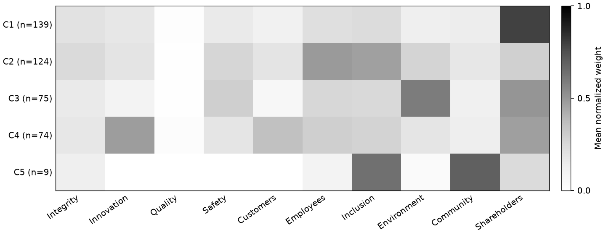

# Part 4: Disclosure Profiles

## Research question and findings

**Do companies show different patterns in the priorities they discuss, and do these patterns change over time?**

This part uses clustering to group companies based on the themes emphasized in their annual proxy statements. Rather than assuming that companies in the same sector have similar priorities, the analysis looks for patterns directly in their disclosure language.

The analysis also examines whether companies move between groups over time and how these groups compare on the Part 3 Authenticity Index.

The most interesting finding is that **one cluster appears to reflect problems with how themes are identified, rather than a genuinely distinct organizational profile**. This highlights why statistical patterns need to be checked against their original source documents.

## Methodology

The analysis uses **421 company-year observations from 49 companies**, covering 2016–2024.

Each proxy statement is represented by the same ten themes used in Parts 1 and 2: Integrity, Innovation, Quality, Safety, Customers, Employees, Inclusion, Environment, Community, and Shareholders.

The theme shares are normalized so that clustering focuses on the **relative importance of different themes**, rather than the overall amount of theme-related text. A paragraph can contribute to multiple categories, so the original shares do not necessarily add up to 100%. Individual themes are not separately standardized, avoiding excessive influence from rarely detected categories.

I used **K-means clustering**, which groups observations with similar patterns.

I tested solutions containing two to five clusters and compared them using the *silhouette score*. This measures how well observations fit within their assigned groups compared with other groups. Higher values generally indicate clearer separation.

The clustering was repeated from different starting points to check whether the results were consistent. Company names, sectors, years, tone scores, and authenticity scores were not used to create the groups. They were considered afterward to help interpret the results.

## Preliminary findings

The five-cluster solution achieved the highest silhouette score of **0.234**, although the difference from alternatives was small. The scores for two, three, and four clusters were 0.227, 0.223, and 0.222, respectively.

This suggests that some patterns exist, but the groups are not sharply separated. Twelve observations also fit another cluster better than their assigned one. The five clusters should therefore be treated as exploratory profiles rather than established organizational types.

| Cluster | Main themes | Company-years | Available index scores | Median index |
|---|---|---:|---:|---:|
| C1 | Shareholders | 139 | 37 | 63.4 |
| C2 | Employees and Inclusion | 124 | 50 | 72.6 |
| C3 | Environment, Shareholders and Safety | 75 | 34 | 69.3 |
| C4 | Innovation, Customers and Shareholders | 74 | 26 | 72.2 |
| C5 | Community and Inclusion matches | 9 | 6 | 57.2 |



The figure shows the average relative emphasis of each theme within a cluster. Darker cells indicate greater emphasis, not the percentage of the entire document devoted to that theme.

### What the clusters reveal

**Sector differences:** C3 is strongly associated with Energy companies, which account for 56 of its 75 observations. However, overall agreement between clusters and sector classifications is relatively low (adjusted Rand index = 0.144). This suggests that sector membership alone does not explain the observed patterns.

**Changes over time:** Companies switched clusters in **96 of 360 valid consecutive-year comparisons (26.7%)**, involving 40 companies. Missing years were not treated as transitions. These changes suggest that disclosure profiles can shift, although a cluster switch does not necessarily reflect a change in company behavior.

**Connection to authenticity:** The clusters have different median Authenticity Index scores, but these comparisons are descriptive. Only 153 company-year observations have complete Part 3 scores, and the same theme measures contribute to both analyses. Differences between clusters therefore cannot independently validate the index.

### An important finding: Berkshire Hathaway

**Cluster C5 consists entirely of Berkshire Hathaway's nine annual proxy statements.**

Initially, this might suggest that Berkshire Hathaway has a particularly distinctive combination of Community and Inclusion priorities.

However, reviewing its 2016 and 2024 proxy statements revealed a different explanation.

Some Inclusion matches refer to including shareholder proposals in a proxy statement or describe a committee that does not seek diversity when selecting directors. Community matches frequently concern directors' charitable-foundation backgrounds.

Although these passages contain words matched to the categories, they do not necessarily demonstrate company commitments to Inclusion or Community.

This is an important limitation of the text-mining approach in Part 2. **A statistically distinct cluster may result from misleading keyword matches or document structure rather than meaningful differences in corporate priorities.**

The clustering analysis therefore provides a useful way to identify potential problems in the underlying measurement process.

## Reliability checks and limitations

I checked whether the results were sensitive to different starting points and data-quality issues.

- Repeated clustering runs showed strong agreement (average adjusted Rand index of **0.930**), although four clusters were even more consistent (**0.999**).
- Excluding 51 filings with extraction warnings and repeating the five-cluster analysis produced similar groupings (**0.954** agreement on the 370 retained observations).

These results suggest that the clustering is reasonably stable, but **stability does not prove that the groups represent real organizational differences**.

The main limitations concern how priorities are measured. Keyword matching cannot always distinguish company commitments from procedural language, negative statements, or information about individual directors. Proxy templates and repeated sections can also influence theme shares.

Additionally, the 421 observations represent repeated filings from 49 companies, not 421 independent organizations. K-means will also create groups even when the underlying patterns are weak.

### Realistic improvements

With additional time, I would focus on three improvements:

1. **Review a small sample of questionable passages**, especially those responsible for unusual cluster assignments such as Berkshire Hathaway's.
2. **Refine ambiguous theme-matching rules** and check whether correcting these matches changes the affected cluster assignments.
3. **Compare similar sections of proxy statements** for a smaller group of companies to reduce differences caused by document structure.

These checks would help establish whether the identified patterns reflect meaningful disclosure priorities rather than artifacts of text processing.

## Dataset and reproduction

The [output dataset](outputs/dataset.csv) retains all **450 company-year observations**, including 29 without usable disclosure profiles. Missing observations are not assigned to clusters.

| Columns | Description |
|---|---|
| `ticker`, `company_name`, `sector`, `year` | Company and year identifiers |
| `theme_shares` | Ten theme measures from Part 2 |
| `cluster` | Assigned disclosure group (1–5) |
| `cluster_silhouette` | How well an observation fits its assigned cluster |
| `cluster_changed_from_prior` | Whether the cluster changed from the previous year |
| `authenticity_index`, `score_basis` | Part 3 scores and available evidence, used only for comparison |
| `quality_flags` | Missing data and extraction-quality concerns |

Missing numerical values remain blank rather than being treated as zero.

The [implementation](../src/part4/) uses the existing Part 2 and Part 3 datasets without additional API or LLM requests. The saved results use scikit-learn 1.9.1.

```sh
uv sync
uv run python -m src.part4
```